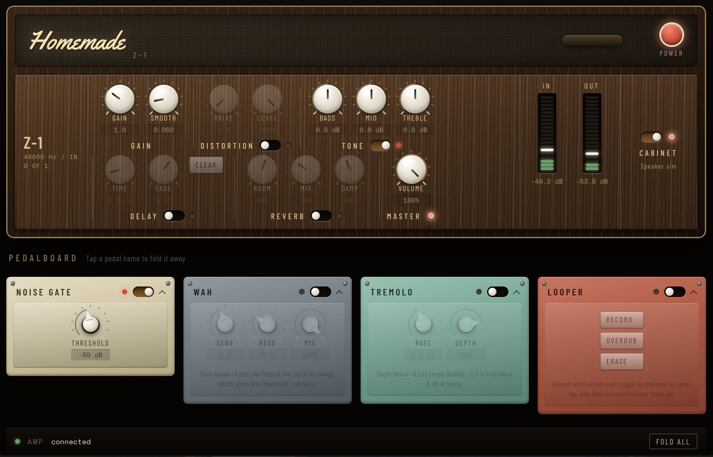

# Homemade Amp

A guitar amp that runs on your computer. Plug a guitar into an audio interface, and play.

I built this for fun, to understand how amps and effects actually work rather than just
using them. All effects, amp setup and audio handling is written from scratch. It is open source so that anyone
can add more effects on top of it.

<p align="center">
  
</p>

## Requirements

- `g++` with C++17, and `make`.
- An audio interface and a guitar. **Use headphones** — speakers near a pickup will
  feed back and squeal.

No packages to install. Both libraries are single headers already vendored in `external/`.

<em>Note: Was developed and tested on MacOS.</em>

## Running it

```bash
make          # build ./amp
make run      # terminal version   (same as ./amp cli)
make gui      # browser version    (same as ./amp gui)
make test     # offline tests, no audio device needed
make clean
```

There are two ways to drive the amp, chosen at startup: control through cmd line, or through GUI. 

### Browser — `make gui`

```bash
make gui
```

Then open **http://127.0.0.1:8080**.

The page gives you knobs you can drag or type into, a level meter, and a strip showing
the live level on each input channel so you can click the one your guitar is in.

### Terminal — `make run`

Type short commands at a prompt. Good for quick experiments.

```
CMD: ds          toggle distortion
CMD: dr 8.5      set drive to 8.5
CMD: pk          show input/output peak levels
CMD: q           quit
```

`pk` and `ic` are the diagnostics worth knowing: `pk` prints the peak level on every input channel, and
`ic auto` listens for a few seconds and picks whichever channel your guitar is actually
plugged into.

## File structure

```
.
├── src/
│   ├── main.cpp   audio device setup, HTTP server, terminal loop
│   ├── amp/       the Amp struct: combines every effect, handles adjustments
│   └── effects/   all the effects, one header + implementation per category
├── ui/            the browser front end
├── tests/         effects, server, knob handling
└── external/      miniaudio and httplib
```

## What's in it

The effect chain, in order:

```
input → noise gate → loop → gain → wah → distortion → EQ → tremolo → cabinet → delay → reverb → master → out
```

| Effect | What it does | On at startup |
|---|---|---|
| Noise gate | shuts the signal below a threshold so the amp isn't hissing | yes |
| Looper | records the dry guitar and plays it back | no |
| Gain | input level into the distortion | always |
| Auto-wah | envelope-driven resonant bandpass, 400 → 2200 Hz | no |
| Distortion | `tanh` soft clipping | no |
| EQ | bass / mid / treble, ±15 dB | yes |
| Tremolo | sine LFO on the amplitude | no |
| Cabinet | replicating physical amp sound | yes |
| Delay | delay up to 2 s | no |
| Reverb | Freeverb: 8 comb filters + 4 allpasses | no |
| Master | output volume | always |

## Adding an effect

The pieces are deliberately boring so they're easy to copy:

1. Add a `struct` to one of the `src/effects/*.h` files — plain data members plus an
   `init(sampleRate)` and an `applyX(float sample)` that returns the processed sample.
2. Add it to `Amp` in `src/amp/amp.h`, call its `init()` from `Amp::init()`, and drop it
   into the chain in `Amp::processAudio()`.
3. Anything the user can change is a `std::atomic` with a clamping setter on `Amp`.

## Changing GUI

The API, if you want to drive it from something else:

| Endpoint | Purpose |
|---|---|
| `GET /knob?name=&value=` | set a continuous value |
| `GET /switch?name=&value=0\|1` | switch an effect on or off |
| `GET /switch?name=loop_record` | one-shot actions (also `loop_overdub`, `loop_reset`, `delay_reset`) |
| `GET /state` | every current value, as JSON |
| `GET /results` | `[peakIn, peakOut, ch0, ch1, …]` for the meters |
| `GET /input?channel=N` | choose the guitar's input channel |
| `GET /quit` | shut the amp down |

## Credits

- [miniaudio](https://miniaud.io) by David Reid
- [cpp-httplib](https://github.com/yhirose/cpp-httplib) by yhirose
- [Audio EQ Cookbook](https://www.w3.org/TR/audio-eq-cookbook/) by Robert Bristow-Johnson, for the biquad filters
- Freeverb by Jezar at Dreampoint, for the reverb
- UI implemented entirely with claude code
